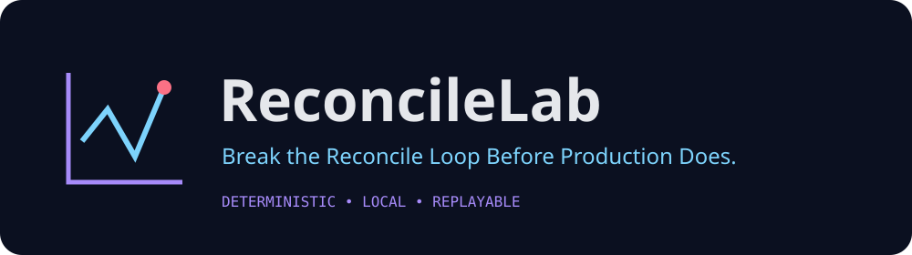
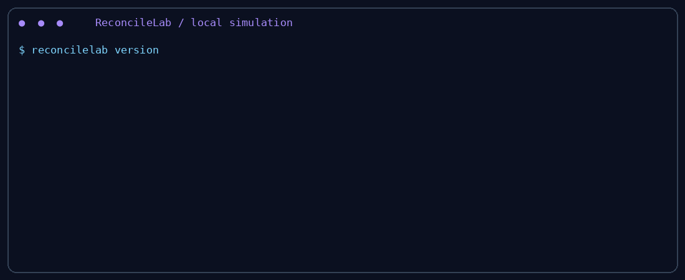
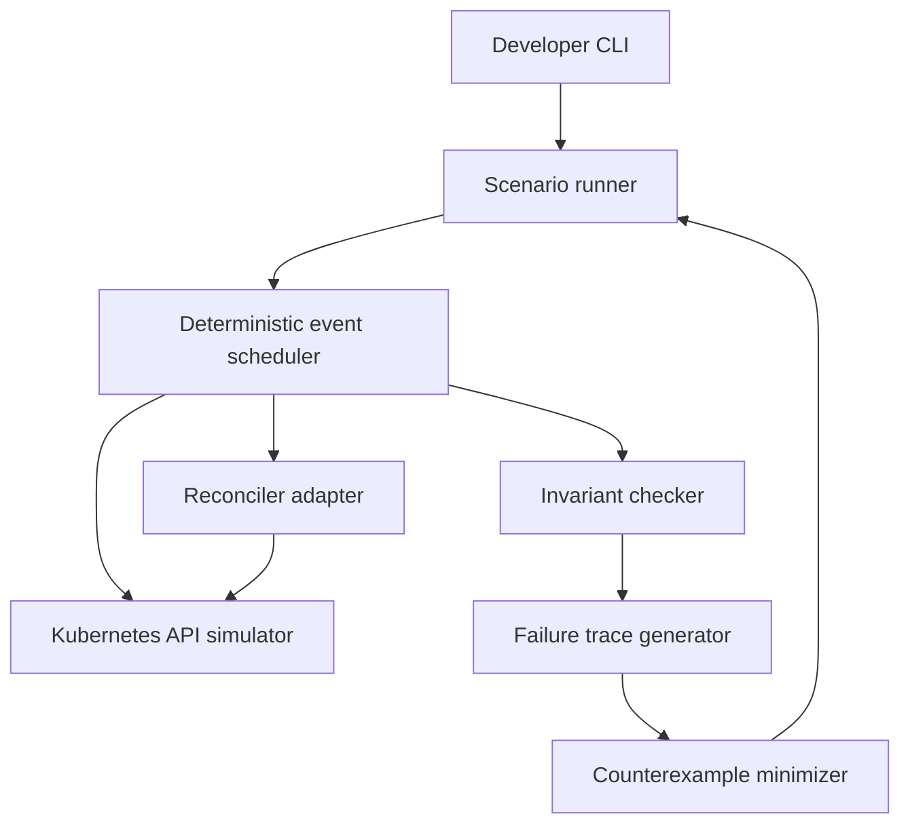

<p align="center"></p>
<p align="center"></p>
<p align="center"><strong>Break the Reconcile Loop Before Production Does.</strong></p>
<p align="center">
<a href="LICENSE"></a>

<a href="https://github.com/sohamdev77/reconcilelab/actions/workflows/ci.yml"></a>

</p>

> Development preview. Local simulator, executable Go adapters, no cluster or account required. Repository links assume publication at `sohamdev77/reconcilelab`; remote CI and a tagged release have not been verified.

<p align="center"></p>

[Static terminal demonstration](assets/demo.svg) · [Captured output](assets/demo.txt) · [Architecture](docs/architecture.md) · [Scenario format](docs/scenario-format.md)

## The problem

A reconcile function can pass ordinary unit tests and still corrupt a resource after an ownership handoff. Duplicate requests, stale cached objects, conflicts, and changes between calls expose assumptions that a single happy-path test misses.

## Why ReconcileLab exists

ReconcileLab makes selected interleavings explicit and replayable. It complements controller-runtime unit tests and EnvTest rather than replacing Kubernetes integration tests. It makes no claim to be the first controller-testing tool or a complete distributed-systems model checker.

## Features

- Versioned YAML/JSON scenarios, fixed seeds, ordered execution and operation traces.
- ConfigMap creation, reads, updates and deletion with resource-version conflicts.
- Explicit cache freezing and synchronization, one-shot error queues.
- Ownership/deletion predicates and Go hooks for custom invariants.
- Seeded, bounded permutation sampling and chunk-deletion shrinking.
- JSON reports, YAML counterexamples and replay verification before saving minimized failures.
- Cobra commands with CI exit codes: **0** passes, **1** invariant violation, **2** configuration/execution error.

## How it works

A scenario supplies initial objects and ordered actions. A registered factory constructs a fresh reconciler around the simulator client for each run. External mutations change live state; frozen cache reads remain stale until a `sync` action. Reconcile errors are recorded and the next explicit action proceeds. Invariants examine live state immediately before and after each reconcile.



The scheduler is a sequential state machine, not a workqueue or informer implementation. The simulator distinguishes live writes from cached observations. The minimizer creates fresh clients/controllers and checks that the same named invariant still fails after actions are removed.

## Installation

Requires Go 1.26 or newer. From this source checkout:

```sh
go mod download
go build -o bin/reconcilelab ./cmd/reconcilelab
./bin/reconcilelab version
```

After the repository is published, `go install github.com/sohamdev77/reconcilelab/cmd/reconcilelab@<tag>` can install a published tag. No tag is claimed to exist today. Release CI builds archives and SHA-256 checksums; verify checksums before using downloaded binaries.

## Quick start

```sh
./bin/reconcilelab init
./bin/reconcilelab validate reconcilelab.yaml
# Expected exit 1: starter demonstrates an unsafe ownership overwrite.
./bin/reconcilelab test reconcilelab.yaml --seed 42
./bin/reconcilelab replay results/counterexample.yaml
# Same minimized regression, corrected implementation: exit 0.
./bin/reconcilelab replay results/counterexample.yaml --adapter fixed
./bin/reconcilelab report results/run.json
```

Full unshrunk evidence is retained in `results/run.full.json`. Reports default to `results/run.json`; violations additionally save `results/counterexample.yaml`. Use distinct `--output` directories when keeping multiple runs. `--format json` emits only JSON on stdout; errors go to stderr. `report` renders a saved report and returns 0 on successful rendering, even if it describes a violation.

## A real controller regression

```sh
./bin/reconcilelab test ./examples/basic-controller --output results/buggy
./bin/reconcilelab test ./examples/basic-controller --adapter fixed --output results/fixed
```

The sample uses a typed `corev1.ConfigMap` and the real controller-runtime `reconcile.Reconciler` interface. The faulty version assumes a requested object belongs to it and overwrites its `owner` label. The corrected version checks ownership before writing. The full scenario freezes cache visibility, transfers ownership externally, issues a duplicate request, synchronizes the cache and reconciles again. Shrinking reveals that the essential bug needs only the handoff and one reconcile; stale reads are not necessary for this particular bug.

See [executable adapter](pkg/adapter/adapter.go) and [regression/replay tests](pkg/engine/engine_test.go). The failure is computed from actual state changes, never hardcoded.

## Supported failure scenarios

| Behavior | Mechanism | Boundary |
|---|---|---|
| Duplicate/reordered requests | Repeated/permuted `reconcile` actions | Sequential calls only |
| External changes/deletion | `mutate`, `create`, `delete` actions | ConfigMaps only |
| Stale observations | `freeze` then `sync` | Whole cache snapshot |
| Optimistic conflicts | Mismatched resourceVersion | Updates only |
| Temporary failures | `inject` for get/create/update/delete | FIFO, one-shot |
| Ownership corruption | Default ownership predicate | Labels and ownerReferences |
| Unexpected deletion | Default no-deletion predicate | During reconcile only |
| Idempotency/mutation | Opt-in Go predicates | Caller declares convergence and protected state |

## Counterexample replay

```sh
./bin/reconcilelab replay fixtures/failure.yaml --minimize=false --output results/full
./bin/reconcilelab replay results/buggy/counterexample.yaml --output results/replay
./bin/reconcilelab test examples/duplicate-reconcile --adapter fixed --explore 8 --seed 42
```

`--explore` samples at most the supplied number of seeded action permutations and stops at the first violation. It is not exhaustive exploration. An invalid permutation is an execution error, not a passing schedule. Explicit replay does not reorder actions. Results are deterministic for the same implementation, Go/dependency versions, adapter, initial state, actions and seed; wall-clock timestamps are absent.

## Technical architecture

| Package | Responsibility |
|---|---|
| `pkg/scenario` | Strict YAML loading, validation, serialization |
| `pkg/simulator` | ConfigMap storage, cache, conflicts, fault queues, operation log |
| `pkg/adapter` | Fresh reconciler factories and working sample |
| `pkg/invariant` | Small state predicates and violation evidence |
| `pkg/engine` | Ordered execution, bounded exploration, shrinking |
| `internal/cli` | Cobra commands, report output and exit codes |

Public APIs are experimental at v0.1.0-dev. See [architecture](docs/architecture.md), [adapter contract](docs/adapters.md), and [invariant assumptions](docs/invariants.md).

## How ReconcileLab Was Engineered

1. **Identifying the problem.** Reconciliation correctness depends on observed versus current state, not simply request ordering.
2. **Researching existing tools.** [controller-runtime](https://pkg.go.dev/sigs.k8s.io/controller-runtime/pkg/reconcile) supplies the reconciler contract. Its [fake client documentation](https://pkg.go.dev/sigs.k8s.io/controller-runtime/pkg/client/fake) warns about API fidelity. [EnvTest](https://book.kubebuilder.io/reference/envtest) runs a real API server and etcd, but no built-in controllers. Chaos testing can exercise live failures; this MVP instead enumerates controlled local actions, without cluster chaos or claims of concurrency completeness.
3. **Designing execution.** [engine](pkg/engine/engine.go) separates mutations, cache controls, faults and reconcile requests. [simulator](pkg/simulator/client.go) snapshots copied state and checks update versions.
4. **Implementing invariants.** [predicates](pkg/invariant/invariant.go) compare before/after snapshots. External handoffs are permitted; controller writes that steal ownership are rejected.
5. **Generating counterexamples.** Reports include initial objects, ordered actions, observed snapshots, API results and expected/actual violation evidence. Shrinking removes chunks and verifies the named failure by replay.
6. **Validating the system.** Unit and integration coverage is described in [verification](docs/verification.md), including actual local command results and limits. CI configuration is not evidence that remote CI ran.
7. **Preparing contributions.** The [contribution guide](CONTRIBUTING.md), [20 proposed issues](docs/proposed-issues.md), and regression fixtures identify scoped extensions with acceptance criteria.

## Limitations and roadmap

This is an experimental local testing MVP. ConfigMap CRUD only; no API discovery, List/Patch/status, admission/defaulting, schema validation, finalizers, garbage collection, informer watches, real workqueue retries, concurrent calls, or automatic requeue scheduling. Unsupported client operations fail explicitly. Factories and invariants are trusted Go code and may themselves access the OS/network; this is not a sandbox. Scenario data is not executed as code. Snapshots may contain sensitive ConfigMap data; do not commit private inputs or reports.

Next priorities: richer operation-level invariants, resource generalization, API-conformance tests against EnvTest, causal exploration that preserves mutation prerequisites, and finalizer semantics. See [limitations](docs/limitations.md).

## Contributing

Start with [CONTRIBUTING.md](CONTRIBUTING.md). Proposed issue labels include `good first issue`, `help wanted`, `bug`, `documentation`, `feature`, `testing`, `controller-runtime`, and `performance`. The issue proposals are local documents; no GitHub issues have been created.

## Development setup

```sh
make test
make race
make vet
make build
make docs
make cross
```

Install Pillow (`python3 -m pip install Pillow`) for demo rendering. `make demo` regenerates visual assets from real CLI output using Python Pillow. `make cross` checks compilation, not native execution. Docker is optional: `docker build -t reconcilelab .`; the image defaults to `version`. No Kind cluster is needed or contacted.

## Built by Superintelligence. Prompted by a Developer Who Had Other Plans.

> This project was built with the assistance of superintelligence.
>
> The developer who prompted it, Soham Das, has enough technical knowledge to build it himself. However, he had more important things to do: drink his Monster Energy, watch his favorite show, and enjoy his evening.
>
> So, instead of spending hours writing boilerplate, debugging Kubernetes edge cases, and arguing with Go interfaces, he handed the assignment to his AI companion.
>
> His instructions were simple: **"Build something genuinely useful, make it open source, and don't embarrass me on GitHub."**
>
> The AI handled the implementation. The human supplied the idea, technical direction, and a questionable amount of caffeine.
>
> Welcome to ReconcileLab. Built with intelligence, powered by curiosity, and supervised by a developer who was probably watching anime.

“Superintelligence” is humorous branding, not a factual claim about the AI system. Implementation and local automated verification were performed by the coding agent. Human review, human testing, production use and remote CI execution have not been confirmed.

## License

[Apache License 2.0](LICENSE). Copyright 2026 Soham Das.

## Creator

**Soham Das** · [GitHub](https://github.com/sohamdev77) · [Website](https://sohamdev77.github.io)
