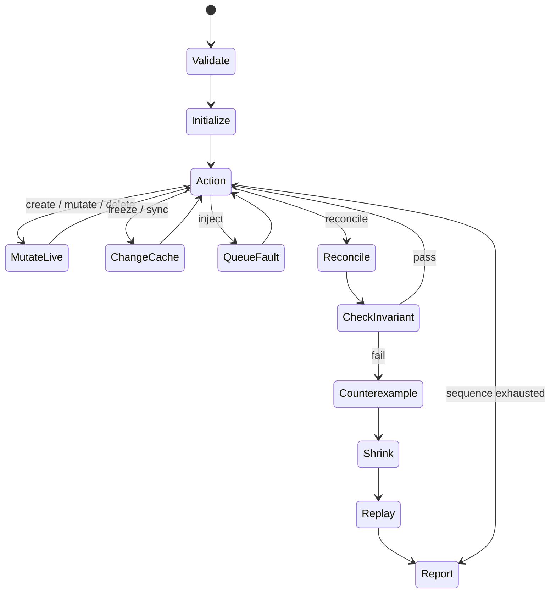

# Architecture

The public packages contain the reusable runtime; internal/cli owns application presentation. A factory receives a simulated controller-runtime client and returns a fresh reconcile.Reconciler. No plugin binaries, arbitrary package loading, kubeconfig, manager, or live cluster connection is used.

Live state is authoritative for update version checks. Reads use a deep-copied cache. Writes refresh cache unless frozen. Sync replaces cache with current live state. Scenario mutations are logged API operations but are outside the reconcile invariant boundary, allowing legitimate external ownership changes.

Each report contains the entire executed scenario, executed prefix, snapshots, operation results and first failing predicate. Minimization preserves predicate name, not a globally unique causal bug identity. Runs are bounded by finite actions; exploration bounds candidate count. A controller that never returns can still hang: isolate trusted harnesses externally with a process timeout.
